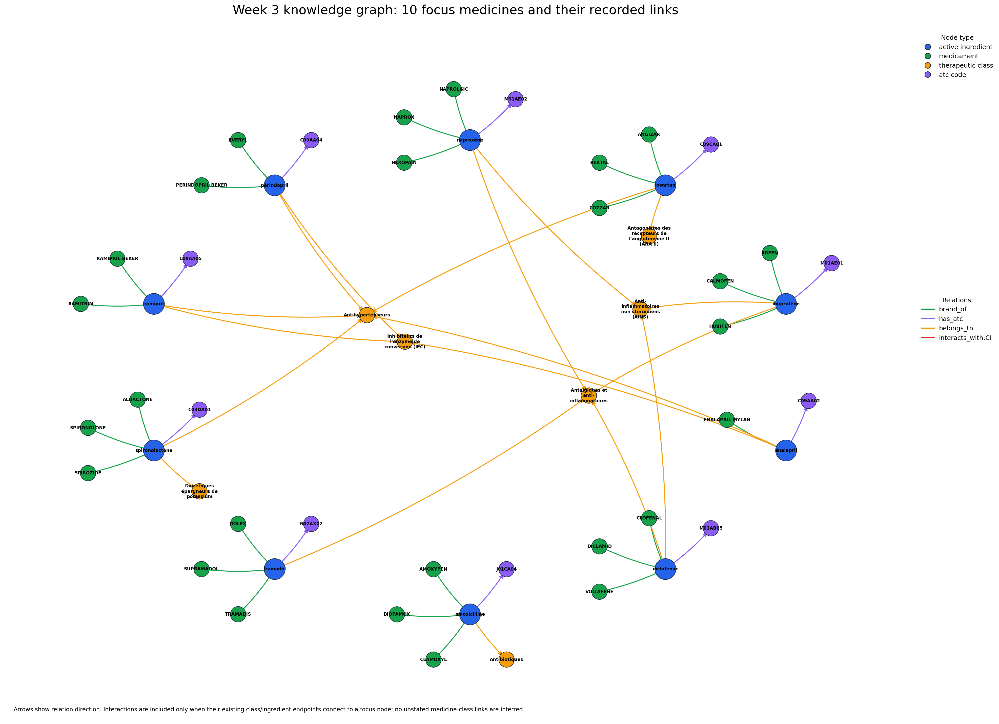

# Week 3 Knowledge Graph: P5 Assembly and Evaluation

## Scope

Merged P2 nomenclature, P3 ANSM interaction, and P4 ANPP contraindication triples. The older `triples_step3.csv` extraction was excluded because it is a separate, unverified dataset.

## Merge and validation

| Input | Triples |
|---|---:|
| P2 nomenclature (`triples_p2.csv`) | 89 |
| P3 ANSM interactions (`triples_p3.csv`) | 4 |
| P4 ANPP contraindications (`triples_p4.csv`) | 49 |
| Exact duplicate rows removed | 0 |
| **Merged triples** | **142** |

The merged graph contains **128 nodes** and **142 directed edges**. Validation passed with 0 error(s).

### Nodes by type

| Type | Count |
|---|---:|
| active_ingredient | 11 |
| atc_code | 10 |
| contraindication | 38 |
| literal | 23 |
| medicament | 36 |
| therapeutic_class | 10 |

## Ten-medicine visualization

All **10 of 10** requested active ingredients are present. The focused drawing contains 53 nodes and 55 recorded relations, including directly connected brands, classes, ATC codes, and relevant P3 interaction edges. Dosage forms and strengths remain available in the full GraphML/CSV but are omitted from this drawing to keep it readable.

## Integration caveat

P4 contributes **10 product-specific contraindication subjects** to the full merged graph. These RCP product/form nodes are not relabeled or falsely connected to the 10 ingredient-level P2 medicines. The P4 facts remain in the merged graph but outside the focused 10-medicine drawing unless a source-backed product-to-ingredient edge is added.

## Outputs

- `data/graph/triples_merged.csv` — merged P2-P4 triples.
- `data/graph/vocab_merged.csv` — current base vocabulary plus P4 entities.
- `data/graph/pharma_knowledge_graph.graphml` — loaded directed multigraph.
- `reports/week3_ten_medicines_graph.png` — focused drawing.
- `reports/week3_graph_report.md` — this summary.
